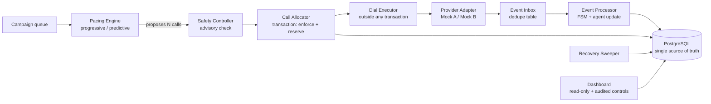

# SmartDialer: Project Report

This is the single document to read first. It explains what was built, why it was built that way, how it was developed, and where to find the evidence for every requirement in the assignment.

---

## 1. Where to look first (for reviewers)

The assignment scores correctness before cleverness. This table points at the evidence for each scoring area.

| Scoring area | Weight | What to read | Proof it works |
|---|---:|---|---|
| System design | 20% | Sections 3-4 here, `docs/ARCHITECTURE.md`, `docs/ADR.md` | Diagrams and ADR entries |
| Distributed systems and concurrency | 15% | `smartdialer/allocator/allocator.py`, `smartdialer/db/schema.sql` | `tests/test_concurrency_progressive.py` |
| Progressive dialing | 10% | `smartdialer/pacing/`, `smartdialer/allocator/` | `tests/test_pacing_progressive.py` |
| Predictive pacing | 15% | `smartdialer/pacing/estimator.py`, `smartdialer/pacing/predictive.py` | `tests/test_estimator.py`, `tests/test_predictive_unit.py`, `tests/test_predictive_integration.py` |
| Safety and correctness | 15% | `smartdialer/safety/controller.py` | `tests/test_safety_controller.py`, `tests/test_audit_bugs.py` |
| Failure handling | 10% | `smartdialer/events/`, `smartdialer/executor/`, `smartdialer/sweeper/` | `tests/test_events.py`, `tests/test_executor.py`, `tests/test_sweeper.py`, `tests/test_simulation_failures.py`, `smartdialer/sim/failures/` |
| Testing and performance | 10% | `tests/`, `smartdialer/loadtest/` | `docs/loadtest_results.md`, `docs/simulation_results.md` |
| Code quality and documentation | 5% | This report, README, `docs/` | n/a |

**The five-minute path:**

1. Read Section 2 (the idea) and Section 5 (key decisions).
2. Open `docs/ARCHITECTURE.md` for the diagrams.
3. Run the live dashboard (`python -m smartdialer.dashboard.live --scenario A --agents 100 --speed 10 --seed 42`) and follow the demo script in `docs/DASHBOARD.md`.
4. Run `pytest -v` and one failure demo, for example `python -m smartdialer.sim.failures.worker_crash`.

---

## 2. The problem and the core idea

**Problem.** Collections agents idle while waiting for calls to connect. Progressive dialing (one agent, one call) is safe but leaves agents idle. Predictive dialing starts calls before an agent is free, betting on how many people will answer. Its risk: more people answer than there are agents. An abandoned connected call can be a compliance issue.

**Idea.** Get predictive utilization with progressive-style determinism by separating *how much to dial* from *whether it is safe*.

1. The **pacing engine** proposes a number of calls using a pessimistic answer rate (an upper confidence bound), sized so that the probability of more answers than agents stays below a small epsilon (a binomial tail bound).
2. The **Safety Controller** is a deterministic rule set with no authority from the estimator. It can approve, reduce, reject, or force a fallback to progressive. Pacing has no handle to disable it.
3. The **allocator** re-runs the safety check inside the database transaction that reserves resources, so a stale advisory check cannot cause an unsafe commit.
4. If measured abandonment exceeds its budget, the system **automatically falls back to progressive** until it recovers.

The estimator only decides how much of the safe headroom is used. It never decides how much headroom exists.

---

## 3. Architecture



**One database is the source of truth.** Workers hold no state between ticks. There is no cache, so there is no cache-versus-database disagreement to defend.

### Call flow (one call, start to finish)

1. A tick reads a fresh snapshot (free agents, in-flight calls, abandonment rate, provider health).
2. Pacing proposes N calls. Safety advises. The allocator opens a transaction, safety **enforces** again against fresh counts, then reserves agents and borrowers with `FOR UPDATE SKIP LOCKED` and inserts the call as `RESERVED`. Commit.
3. The dial executor calls the provider **outside** any transaction, using the call ID as idempotency key.
4. A second short transaction records the result: accepted becomes `INITIATED`, rejected becomes `FAILED` and releases resources, timeout becomes `UNKNOWN` (resources stay held, never blindly retried).
5. Provider events (`RINGING`, `ANSWERED`, `COMPLETED`, `FAILED`) are written to the inbox first, then processed in a transaction that locks the call row, applies the state machine, and updates the agent.
6. In predictive mode, an agent is claimed at `ANSWERED` time. If none is free the call is held briefly, then connected or recorded as `ABANDONED`. Abandonment feeds back into Safety.

### Two terms to keep straight

- **ANSWERED:** the provider says a human picked up.
- **CONNECTED:** an agent is bridged to the call. A call is only *safely connected* at this point. Abandonment lives in the gap between the two.

### State machines

**Agent:** `OFFLINE`, `AVAILABLE`, `RESERVED`, `DIALING`, `CONNECTED`, `WRAP_UP`, `PAUSED`, with an explicit allowed-transition table (`smartdialer/domain/`). An agent going offline while reserved or dialing releases the call. While connected, the call continues and the agent leaves after wrap-up.

**Call:** `QUEUED`, `RESERVED`, `INITIATED`, `RINGING`, `ANSWERED`, `CONNECTED`, `COMPLETED`, `FAILED`, `CANCELLED`, plus `UNKNOWN` (ambiguous provider outcome) and `ABANDONED` (answered, no agent in time). Transitions are **rank-based**: forward skips are allowed, backward moves are rejected, and terminal states absorb everything. That is why `ANSWERED, ANSWERED, ANSWERED, COMPLETED` and `COMPLETED, ANSWERED, RINGING` both end in a sensible state.

---

## 4. Stack and why

| Choice | Why | What it makes harder |
|---|---|---|
| Python 3.11 | Fast to build and fully explainable in the time box | Lower per-process throughput than Go or Rust; scaling relies on more processes |
| PostgreSQL 16 | Row locks, `SKIP LOCKED`, partial unique indexes, advisory locks: exactly the primitives this problem needs | Single primary is the eventual ceiling |
| SQLAlchemy 2.x + psycopg3 | Explicit transaction and locking control | More verbose than an ORM-only approach |
| `create_all` + `schema.sql` | No migration tooling to set up; partial indexes need raw SQL anyway | No versioned migrations |
| pydantic | Typed config and result objects | Minor overhead |
| threading, one session per thread | Enough to prove and test concurrency | GIL limits CPU-bound work |
| Statistics (Beta-Bayesian plus binomial bound), no ML | The assignment says a statistical approach is fine; it is explainable line by line | Cannot capture rich features |
| FastAPI + static HTML (dashboard only) | Makes "why this many calls right now" visible; kept out of the dialing path | Extra dependency, isolated to one package |

**Deliberately not used:**

- **Redis:** it would create a second source of truth, and agent reservation could not be atomic with the call insert in Postgres.
- **Celery:** its at-least-once retries conflict with the rule never to blindly retry an ambiguous provider call, and a real broker makes deterministic simulation hard.
- **Kafka or microservices:** nothing in the load test justified them. They belong in the scaling plan, not the prototype.

---

## 5. Key design decisions

| Decision | What it solves |
|---|---|
| `FOR UPDATE SKIP LOCKED` to claim agents and borrowers | Two workers can never reserve the same row. A worker that finds a row locked skips it instead of waiting. |
| Partial unique indexes (one active call per agent, one per borrower) | A database-level backstop: even a buggy allocator cannot double-book. |
| Safety re-check inside the allocator transaction | Advisory checks go stale; the commit-time check is authoritative. |
| Provider calls outside transactions (3-step flow) | No locks held during slow network calls; a crash leaves a durable row for the sweeper. |
| Idempotency key = call ID; timeout becomes `UNKNOWN` | A timeout does not prove rejection. Retrying blindly could dial a borrower twice. |
| Event inbox with `ON CONFLICT DO NOTHING` | Duplicate events dedupe for free, and events are durable before processing, so they are replayable after a crash. |
| Rank-based call FSM | Duplicates and out-of-order events converge to the same final state. |
| Answer-time agent claim in predictive mode | Dialing more than the free agent count is the point of predictive mode, so agents cannot be reserved 1:1 up front. |
| Upper-bound answer rate with drift guard (`p_hi = max(long, recent)`) | The dangerous error is *underestimating* the answer rate (a jump from 10% to 70%). A drop from 70% to 10% only wastes agent time. |
| Sweeper under a Postgres advisory lock | Only one sweeper acts at a time, and a crashed sweeper is simply replaced. |

### Pacing formula

```
capacity   = free agents + agents expected to finish wrap-up within the ring window
inflight   = calls in INITIATED or RINGING
max_calls  = largest N such that P(Binomial(N, p_hi) > capacity) <= epsilon
requested  = max(0, min(max_calls - inflight, queue_size))
```

Every decision records its inputs, intermediate values, and a plain-language reason (for example, "capacity=12, p_hi=0.41, inflight=9, N*=31, requested=22 (limited by binomial bound)"). That answers "why did it start this many calls right now?" for any row in the decision table.

### Safety Controller rules

| Rule | Behaviour |
|---|---|
| R1 | Progressive mode never approves more calls than free agents (hard limit) |
| R2 | Predictive mode: in-flight plus approved must not exceed capacity times the overdial cap |
| R3 | Rolling abandonment above budget forces fallback to progressive, with hysteresis to avoid flapping |
| R4 | Unhealthy or circuit-open provider receives no new dials |
| R5 | Missing, stale, or low-sample estimate forces fallback to progressive |
| R6 | Operator kill switch, written only through the safety operator API; the pacing package does not import it |

### Honest note on "ML"

No trained machine-learning model is used. The assignment asked for a sensible statistical or rule-based approach, and the Beta-Bayesian estimator sits behind a single `predict_answer_rate()` interface, so a trained model could be swapped in later without touching pacing or safety.

---

## 6. How the project was developed

Development followed a strict phase order, with tests passing before each next phase. The work was done with an AI coding assistant (Antigravity) driven by phase prompts. I reviewed the concurrency, recovery, and safety code myself because those are the parts I can be asked to explain and change live.

| Phase | Built | Main evidence |
|---|---|---|
| 1. Foundation | Schema, typed models, partial unique indexes, agent and call state machines, atomic allocator | `tests/test_call_fsm.py`, `tests/test_concurrency_progressive.py` |
| 2. Unreliable outside world | Provider interface, mock providers A and B, event inbox and processor, dial executor, sweeper, health tracker and circuit breaker | `tests/test_events.py`, `tests/test_executor.py`, `tests/test_sweeper.py`, `tests/test_provider_health.py` |
| 3. Safety and baseline | Safety Controller R1-R6, two-phase check, progressive dialer, orchestrator tick | `tests/test_safety_controller.py`, `tests/test_pacing_progressive.py` |
| 4. Predictive pacing | Beta-Bayesian estimator, binomial-bound pacing, answer-time agent claim, hold timeout, capacity-drop guard | `tests/test_estimator.py`, `tests/test_predictive_unit.py` (with Hypothesis), `tests/test_predictive_integration.py` |
| 5. Simulation | Deterministic engine with fake clock and seeded RNG, scenarios A-D, three strategies, invariant checker, six failure demos | `tests/test_simulation.py`, `tests/test_simulation_failures.py`, `docs/simulation_results.md` |
| 6. Load test and docs | Load test at 100, 1,000, and 10,000 agents with `EXPLAIN (ANALYZE, BUFFERS)`, architecture, ADR, scaling, limitations, final answer | `docs/loadtest_results.md`, `docs/` |
| 7. Adversarial review | Hostile audit of races, swallowed exceptions, terminal-state overwrites; bugs reproduced with failing tests, then fixed | `tests/test_audit_bugs.py` |
| 8. Dashboard | Read-only, non-locking endpoints and an audited operator console, kept out of the dialing path | `tests/test_dashboard.py`, `docs/DASHBOARD.md` |

The full suite is 215 tests running against real PostgreSQL, asserting database state and invariants rather than only internal calls.

---

## 7. Failure scenarios and how each is handled

| Scenario | Mechanism | Where demonstrated |
|---|---|---|
| Two workers reserve the same agent | `SKIP LOCKED` row claim, plus unique-index backstop | `tests/test_concurrency_progressive.py` |
| Worker crash after reserve or initiate | Lease expiry; sweeper reconciles using provider status or the same idempotency key; otherwise conservative cancel | `sim/failures/worker_crash.py`, `tests/test_sweeper.py` |
| Provider timeout | Call becomes `UNKNOWN`; never blindly retried; reconciled later | `tests/test_executor.py` |
| Provider outage | Health tracker and circuit breaker stop new dials; existing calls keep processing events; pacing falls back | `sim/failures/provider_outage.py` |
| Agents suddenly drop (100 to 40) | Capacity recomputed every tick; new dials stop; excess ringing calls cancelled newest-first; connected calls untouched | `sim/failures/agent_drop.py` |
| Duplicate events | Inbox dedupe plus idempotent transitions; exactly one applied transition | `sim/failures/duplicate_event_storm.py`, `tests/test_events.py` |
| Out-of-order events | Rank-based FSM; late events stored with a reason, never thrown away | `sim/failures/out_of_order_storm.py` |
| Crash after `ANSWERED` received | Event is durable in the inbox before processing; replay is a no-op if already applied | `tests/test_events.py` |
| Answer rate jumps from 15% to 65% | Drift guard raises `p_hi` immediately; overdial cap and abandonment fallback clamp risk | `sim/failures/answer_spike.py` |

The simulator also runs an invariant checker after every tick: no agent or borrower with more than one active call, no terminal call re-opened, in-flight never above the cap, every answered call ends connected or abandoned with a reason, and no held call older than its timeout.

---

## 8. Results

All numbers are generated by real runs and stored in the repository. This report links to them instead of copying them, so they cannot drift out of date.

- **Scenario matrix (A: 20% answer / 120 s, B: 50% / 90 s, C: 70% / 180 s, D: changing), three strategies:** `docs/simulation_results.md`, including a sample of consecutive pacing decisions with their reasons.
- **Load test at 100, 1,000, 10,000 agents:** `docs/loadtest_results.md`, including allocation latency percentiles and query plans.
- **Where predictive did not clearly beat progressive**, the results file says so. Results were reported as measured, not tuned.

Simulation answer rates and talk times are configured parameters, kept separate from the values the estimator learns. They demonstrate system behaviour, not real-world prediction quality.

---

## 9. What guarantees the system does and does not give

**It does provide:**

- No agent or borrower is ever in two active calls (enforced by row locks and by the database).
- Predictive dialing cannot exceed the safety cap regardless of what the estimator claims.
- Duplicate and out-of-order provider events converge to one consistent state.
- Crashes leave durable rows that the sweeper can reconcile.

**It does not provide:**

- Exactly-once execution across an external provider. The guarantee is idempotent processing plus reconciliation.
- Elimination of abandonment in predictive mode. Abandonment is bounded by epsilon, the hold timeout, and the budget fallback, not removed.
- Validation of epsilon or the hold timeout against real telephony. They are policy choices, and mock providers cannot confirm them.

---

## 10. Scaling: what breaks first

Details and evidence are in `docs/SCALING.md`. Summary:

| Agents | First bottleneck | Fix |
|---|---|---|
| 100 | Nothing material | None needed |
| 1,000 | Per-tick in-flight `COUNT` queries and polling | Per-campaign counters owned by one pacing worker; the database stays authoritative |
| 10,000 | Write contention on the agents table and event-inbox ingestion | Partial indexes, batched `SKIP LOCKED` claims, partition by campaign or team with lease-holding owners |
| 100,000 | Single Postgres primary | Shard by campaign or agent pool; introduce an outbox and queue only here |

The state machines do not change at any of these steps. Redis or a queue would arrive as a non-authoritative accelerator at the 1,000 to 10,000 stage, not as a replacement for Postgres.

---

## 11. Known limitations and next steps

Full list in `docs/LIMITATIONS.md`. The most important points:

- Epsilon and hold timeout are tunable policy, not derived truth.
- Mock providers approximate real telephony behaviour but cannot prove it.
- Provider B timeouts have no status query, so ambiguity is resolved by idempotent re-send or a conservative cancel, which can drop a call a human may have answered. This is logged as a distinct "late answer after cancel" event.
- Python threads limit per-process CPU throughput.
- The data is synthetic.

With another week: real telephony integration (Plivo free credit), a quantitative abandonment-versus-utilization tuning study, counters at the 1,000-agent stage, and a chaos test that kills workers at random.

---

## 12. Reproducing everything

See the README for exact commands. In short:

```bash
docker compose up -d
python -m venv .venv && source .venv/bin/activate
pip install -r requirements.txt
python -m smartdialer.db.init_db
pytest -v
python -m smartdialer.dashboard.live --scenario A --agents 100 --speed 10 --seed 42
```

---

## 13. Final question: the short answer

Dial aggressively only up to a bound that is safe under pessimistic assumptions. Size the number of in-flight calls so that the chance of answers exceeding agent capacity stays below a small epsilon, using an upper-bound answer rate that jumps up immediately when the observed rate rises. Enforce that bound in a deterministic controller outside the estimator, and re-check it at commit time against fresh database state. Cap abandonment with an automatic fallback to progressive dialing. The estimator decides how much safe headroom is used, never how much headroom exists. The full 214-word version is in `docs/FINAL_ANSWER.md`.